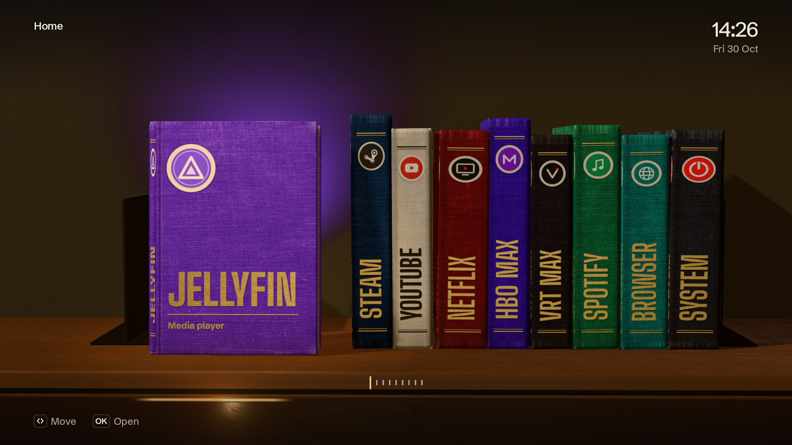
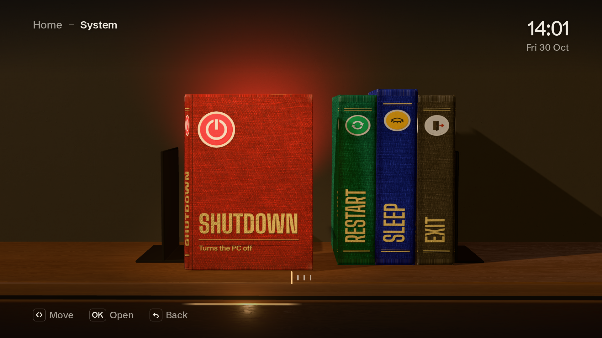
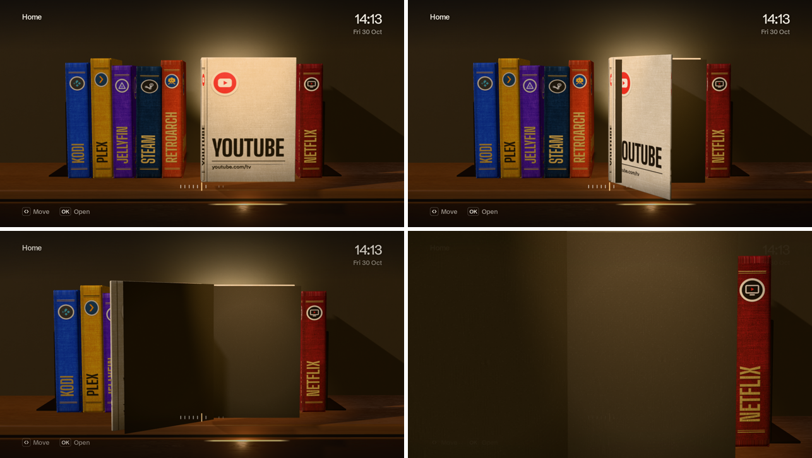
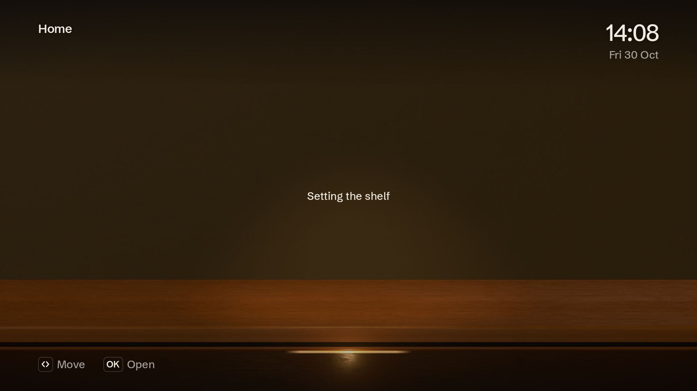

<div align="center">

# Flex Launcher: The Shelf


</div>

This fork replaces Flex Launcher's flat icon row with a lit bookshelf. Every menu entry is a cloth-bound
book with its icon on a paper label and its title in foil; the chosen book turns face-out under a picture
lamp, its colour washes the wall behind the shelf, and opening it swings the cover back and carries the
camera into the first page while the application starts. Everything else is upstream Flex Launcher:
`config.ini`, menus and submenus, hotkeys, gamepads, `.desktop` files, the screensaver, the clock and the
power commands.

It is a native C renderer on OpenGL 3.3 (or OpenGL ES 3.0) inside SDL2, written for a Linux HTPC on a
1080p or 4K TV, including older and low-power GPUs: the scene draws at no more than 1080p, drops its
resolution on its own when frames run slow, and stops rendering entirely while nothing moves.

| Submenu | Opening a book | Loading |
| --- | --- | --- |
|  |  |  |

### Build on Linux

```bash
sudo apt install build-essential cmake pkg-config libsdl2-dev libsdl2-image-dev libsdl2-ttf-dev libinih-dev
cmake -B build -DCMAKE_BUILD_TYPE=Release
cmake --build build
./build/flex-launcher -c build/config.ini
```

`libinih-dev` is optional; a copy of inih is bundled. There is no OpenGL library to link: the functions are
loaded through SDL at start-up, so the same binary runs on Mesa, NVIDIA and AMD drivers, and on GLES-only
boards. `sudo cmake --install build` installs the launcher, `config.ini` and the shelf assets.
Without root, [pixi](https://pixi.sh) builds it from conda-forge: `pixi run launch`.

### Adding and removing books

A book is one line in a menu section of `config.ini`:

```ini
[Home]
Entry1=Kodi;/usr/share/flex-launcher/assets/icons/kodi.png;/usr/share/applications/kodi.desktop
Entry8=HBO Max;/usr/share/flex-launcher/assets/icons/hbomax.svg;chromium --kiosk https://play.hbomax.com
```

Add, delete or reorder lines; the name before `=` only has to be unique within its menu. Its cloth colour
and cover line are optional and keyed by title:

```ini
[Book Colors]
HBO Max=#3B23A8;light   # ;light for gold foil, ;dark for black ink, or leave it out

[Book Notes]
HBO Max=hbomax.com
```

A book without a colour takes one from its icon; power and menu commands get a cover line of their own.
`MaxButtons` under `[Layout]` sets how many books share one stack (10 by default); a menu with more books continues on a second stack.

### Shelf settings

| Section | Setting | |
| --- | --- | --- |
| `[Background]` | `Mode` | `Wall` (default: graphite wall washed in the chosen book's colour), `Color` (the wall in `Color`), `Room` (the photographed room behind the shelf), `Image`, `Slideshow`, `Transparent` |
| `[Shelf]` | `Quality` | `Auto` (default) lowers the scene resolution when frames run slow, `High` renders 4K natively, `Low` for weak GPUs |
| `[Shelf]` | `SpineTitles` | titles on the spines, `true` by default |
| `[Shelf]` | `Assets` | where `fonts/`, `textures/` and `env/` live; found next to the executable or in the install prefix by default |
| `[Shelf]` | `Room` | an equirectangular `.hdr` for `Mode=Room` |

Keys: arrows move, Enter or Space opens, Backspace, Esc or Browser Back goes back, Home goes to the first
menu. A gamepad's D-pad or left stick moves, A opens, B goes back, Guide goes home.

For testing without a TV: `--size 1920x1080` opens a window, `--keys right,right,select` plays a key
sequence and `--capture shot.png --wait 1500` saves the screen afterwards and quits.

Asset licences are listed in [`assets/LICENSES.md`](assets/LICENSES.md).

---

<div align="center">
  <a>
    
  </a>


# Flex Launcher
</div>
<details open>
  <summary>Table of Contents</summary>
  <ol>
    <li>
      <a href="#about">About</a>
    </li>
    <li>
      <a href="#screenshots">Screenshots</a>
    </li>
    <li>
      <a href="#installation">Installation</a>
      <ul>
        <li><a href="#windows">Windows</a></li>
        <li><a href="#linux">Linux</a></li>
      </ul>
    </li>
    <li><a href="#usage">Usage</a></li>
      <ul>
        <li><a href="#controls">Controls</a></li>
        <li><a href="#debugging">Debugging</a></li>
      </ul>
    <li><a href="#development-status">Development Status</a></li>
    <li><a href="#documentation">Documentation</a></li>
    <li><a href="#credits">Credits</a></li>
  </ol>
</details>

## About
Flex Launcher is a customizable application launcher and front end designed with a TV-friendly [10 foot user interface](https://en.wikipedia.org/wiki/10-foot_user_interface), intending to mimic the look and feel of a streaming box or game console. Flex Launcher allows you to launch applications on your HTPC or couch gaming PC entirely by use of a TV remote or a gamepad. No keyboard or mouse required!

Flex Launcher is compatible with both Windows and Linux (including Raspberry Pi devices).

## Screenshots


https://user-images.githubusercontent.com/95071366/208355237-11f00cbb-9cc3-436b-98f7-8de350e584a7.mp4

## Installation
Executables are available for Windows 64 bit, Linux x86-64, and Raspberry Pi. You can also compile the program yourself using the [compilation guide](docs/compilation.md).

### Windows
Download the win64 .zip file from the [latest release](https://github.com/complexlogic/flex-launcher/releases/latest) and extract the contents to a directory of your choice. Flex Launcher should be run on an up-to-date Windows 10 system, or Windows 11.

### Linux
Binary packages are available on the [release page](https://github.com/complexlogic/flex-launcher/releases) for APT and pacman based distributions. You may use the commands below to install.

#### APT-based x86-64 Distributions (Debian, Ubuntu, etc.)
This package is compatible with Debian Bullseye and later, Ubuntu 21.04 and later.
```bash
wget https://github.com/complexlogic/flex-launcher/releases/download/v2.2/flex-launcher_2.2_amd64.deb
sudo apt install ./flex-launcher_2.2_amd64.deb
```
#### Pacman-based x86-64 Distributions (Arch, Manjaro, etc.)
```bash
wget https://github.com/complexlogic/flex-launcher/releases/download/v2.2/flex-launcher-2.2-1-x86_64.pkg.tar.zst
sudo pacman -U flex-launcher-2.2-1-x86_64.pkg.tar.zst
```
#### Raspberry Pi
This package is compatible with Raspbian Bullseye and later, 64 bit only.
```bash
wget https://github.com/complexlogic/flex-launcher/releases/download/v2.2/flex-launcher_2.2_arm64.deb
sudo apt install ./flex-launcher_2.2_arm64.deb
```
#### Copying Assets to Home Directory
The Linux packages install a default config file and assets to `/usr/share/flex-launcher`. It is strongly recommended to *not* edit this config file directly, as it will be overwritten if you upgrade to a later version of Flex Launcher. Instead, copy these files to your home directory and edit it there.
```bash
cp -r /usr/share/flex-launcher ~/.config
sed -i "s|/usr/share/flex-launcher|$HOME/.config/flex-launcher|g" ~/.config/flex-launcher/config.ini
```

## Usage
Flex Launcher uses an INI file to configure the menus and settings. Upon  startup, the program will search for a file named `config.ini` in the following locations in order:
1. The current working directory
2. The directory containing the `flex-launcher` executable
3. Linux only: `~/.config/flex-launcher`
4. Linux only: `/usr/share/flex-launcher`

If your config file is in one of the above locations, Flex Launcher can be started simply by double clicking the executable file or adding it to autostart. If your config file is in a non-standard location, you must specify the path via command line argument:
```bash
flex-launcher -c /path/to/config.ini
```
Flex Launcher ships with a default config file which is intended strictly for demonstration purposes. If you try to start one of the applications, it is possible that nothing will happen because the install path is different on your system, or you don't have the application installed at all. See the [configuration file documentation](docs/configuration.md#configuring-flex-launcher) for instuctions on how to change the menus and settings.

### Controls
The keyboard arrow keys move the highlight cursor left and right. Enter selects the current entry, backspace goes back to the previous menu (if applicable), and Esc quits the program. 

#### TV Remotes
Flex Launcher does not feature built-in decoding of IR or CEC signals. If you plan to use a TV remote to control the device, it is assumed that these signals are decoded by the OS or another program and mapped to keyboard presses, which can then be received by Flex Launcher.

#### Gamepads
Gamepad controls are built-in to the program, but are disabled by default. To enable them, open your configuration file and, under the "Gamepad" section, change the "Enabled" setting from false to true. After that, the gamepad controls should "Just Work" for most users. If your gamepad is not recognized automatically, or you want to change the default controls, see the [gamepad controls documentation](docs/configuration.md#gamepad-controls).

### Debugging
Flex Launcher has a debug mode which may be enabled as follows:
```bash
flex-launcher -d
```
This will output a logfile named `flex-launcher.log` in the same directory as `flex-launcher.exe` on Windows, and in `~/.local/share/flex-launcher` on Linux. 

## Development Status
Flex Launcher has reached a mature state, and there are currently no feature releases planned for the future. I've started a [new HTPC launcher project](https://github.com/complexlogic/big-launcher) which is similar in nature to Flex Launcher, but aims to provide a more advanced, Smart TV-like user interface. My future development effort will be focused on that new project, but I will still maintain Flex Launcher for bugfixes and dependency updates.

## Documentation
Here is a list of available documentation:
- [Configuration](docs/configuration.md#configuring-flex-launcher)
- [General Setup Guide](docs/setup.md#setup-guide)
  - [Windows-specific Setup Guide](docs/setup_windows.md#windows-setup-guide)
  - [Linux-specific Setup Guide](docs/setup_linux.md#linux-setup-guide)
- [Compilation Guide](docs/compilation.md#compilation-guide)

## Credits
Flex Launcher is made possible by the following projects:
- [SDL](https://github.com/libsdl-org/SDL), including the subprojects:
  - [SDL_image](https://github.com/libsdl-org/SDL_image)
  - [SDL_ttf](https://github.com/libsdl-org/SDL_ttf)
- [Nanosvg](https://github.com/memononen/nanosvg)
- [inih](https://github.com/benhoyt/inih)
- [Numix icons](https://github.com/numixproject)

The design of Flex Launcher was strongly influenced by the excellent desktop application launcher [xlunch](https://github.com/Tomas-M/xlunch).
